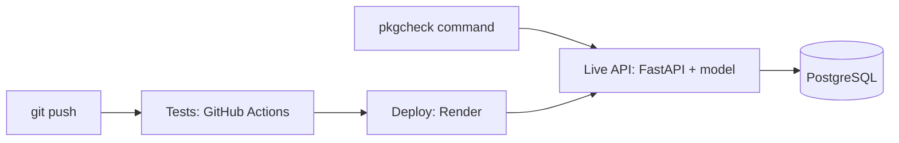

# pkgcheck

A learning project: an end-to-end ML system that flags risky PyPI package **names** before you install them.

    pip install pkgcheck-cli
    pkgcheck requests

## Architecture

## Results (held-out test data)

| Model | Precision (bad) | Recall (bad) |
|---|---|---|
| Logistic Regression | 0.43 | 0.67 |
| Random Forest (deployed) | 0.51 | 0.63 |

The test set is about 27% bad packages. Real PyPI has far fewer, so real-world precision would be lower.

## Honest limits

- This is a learning project, not a security tool.
- The model only uses name-based clues, because most malicious packages were already deleted from PyPI, so their metadata (age, releases, maintainer) can no longer be fetched.
- Safe examples are popular packages, which is not a perfect picture of the real world.
- The free server sleeps when idle, and the free database may expire.
- Retraining from "wrong alert" feedback works, but a few corrections barely change the model.

## What is inside

| Part | Tool |
|---|---|
| Data | DataDog malicious-software-packages-dataset, top PyPI packages list |
| Model | scikit-learn Random Forest, class weights for imbalance |
| API | FastAPI, PostgreSQL, Docker |
| Command | cli folder, published on PyPI as pkgcheck-cli |
| Quality | pytest tests, GitHub Actions CI, auto-deploy on Render |
| Tracking | MLflow runs, Evidently drift report (demo data), retrain script |

## Privacy

The command sends only the package name to the server. The server stores the name and its answer.

## License

MIT